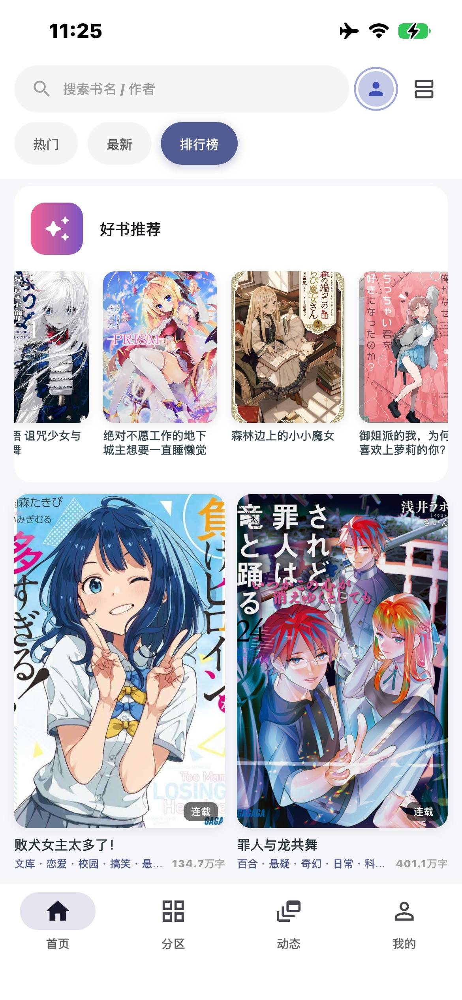
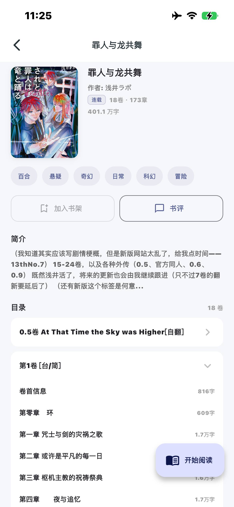
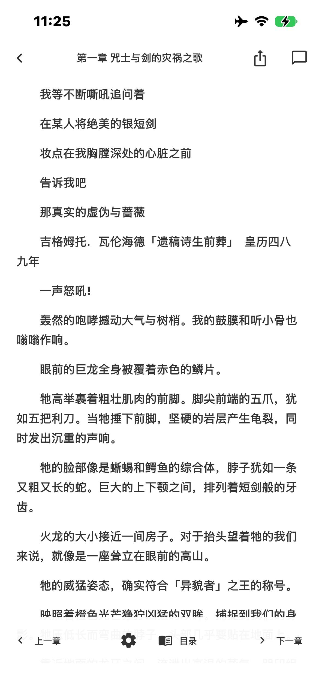

    

    <h1>Yomiru</h1>

使用 Flutter 开发的 轻之国度 第三方客户端，提供更适合手机和平板设备的阅读、书架和社区浏览体验。

  

Yomiru 是一款面向移动端设备的轻之国度第三方客户端，集小说阅读、书架管理和社区交流于一体。

- **社区**：支持动态、书评、章节讨论和访问用户主页。
- **阅读**：支持滚动/翻页阅读、目录、进度记录、正文缓存和简繁体切换。
- **个人中心**：支持用户资料、粉丝关注、作品书架、勋章中心和任务中心。
- **使用体验**：采用缓存优先和后台更新，加载速度更快，适配深色模式、平板、大屏和横屏设备。
- **操作界面**：采用统一的卡片层级，让所有界面保持一致的设计语言。布局会根据设备大小自适应调整，清晰和易于操作。
  
## 数据与隐私

- 作品、章节、社区和账号数据来自轻之国度服务。站点接口、访问权限和内容可能变化，实际可用性以服务响应为准。
- 登录会话凭据通过 `flutter_secure_storage` 保存；主题、阅读偏好、进度及部分缓存保存在本机。
- 已取得阅读权限的章节正文可能缓存在应用私有目录中；正文缓存不属于加密安全存储。图片和其他公开数据也可能缓存在本机。

## 问题反馈

遇到问题时，请先确认官网是否可以正常访问。若官网也无法访问，可能是官方服务或本地网络出现问题；若官网正常而 Yomiru 仍然异常，再通过“设置 → 反馈问题”提交反馈。

## 声明

Yomiru 是非官方第三方客户端，仅用于学习和测试。站点内容和规则可能随时变化，不保证持续可用，亦不提供任何绕过访问控制、付费机制或站点限制的功能。

## 许可证

本项目代码采用 [MIT License](LICENSE)。第三方依赖、轻之国度站点内容及其相关资源分别适用各自的许可或权利声明。
